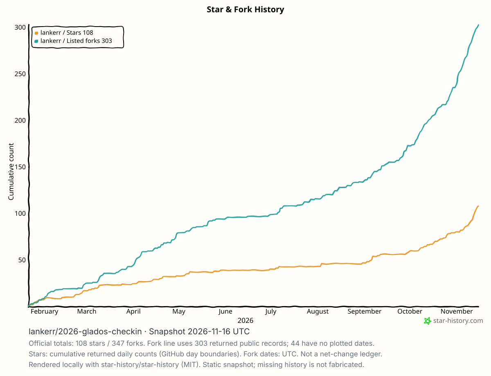

<div align="center">

# GLaDOS Check-in

**本地签到，云端核对。让积分变化有据可查。**

非官方 GLaDOS 社区工具 · Python / GitHub Actions / 可选消息推送

[](https://github.com/lankerr/2026-glados-checkin/actions/workflows/checkin.yml)
[](https://github.com/lankerr/2026-glados-checkin/stargazers)
[](https://github.com/lankerr/2026-glados-checkin/forks)

[快速开始](#quick-start) · [使用手册](docs/usage.md) · [运行边界](#status) · [常见问题](#faq) · [项目趋势](#history)

</div>

---

## 不止看绿灯，更要看结果

| 本地执行，云端核对 | 签到结果与流水分开看 | 通知与排障留有依据 |
| --- | --- | --- |
| 本地尝试签到；云端默认只读核对状态，不把查询当作签到。 | 同时展示接口结果、余额与已读流水，不把历史奖励算作本次成功。 | 可选微信 / Telegram 通知，保留脱敏错误与明确的运行边界。 |

**已有连续实测记录：** 维护者单一账号在 2026-11-14 / 15 / 16 分别观察到 **+10 / +19 / +12** 入账。[查看观察范围与来源](docs/status-notes.md)

<!--STREAK:START-->
> 🔥 **连续自动入账 3 天**（最近 2026-11-16，+12 分）——每日云端只读核对自动更新，官网流水可查
<!--STREAK:END-->

<sub>这是单账号、单环境观察，不保证其他账号或每天成功。实际奖励以官网记录为准。</sub>

<a id="history"></a>
## 项目趋势

[查看 Star History 交互页](https://www.star-history.com/#lankerr/2026-glados-checkin&Date) · [手绘图工具源码](https://github.com/star-history/star-history)

**仓库总数：108 Stars · 347 Forks**

[](docs/star-fork-data.md)

<sub>2026-11-16 静态快照 · Star History 官方手绘组件 · Stars 108；官方 Fork 总数快照 347，递归可枚举 Fork 网络 350（含间接 Fork）。两者口径不同、差异原因未定；图不会自动更新。[数据口径与 CSV](docs/star-fork-data.md)</sub>

---

<a id="quick-start"></a>
## 快速开始

> [!IMPORTANT]
> 完整签到模式默认启用 `EXCHANGE_PLAN=plan500` 积分自动兑换。不希望兑换时先设 `off`；只读模式不会兑换。

### 选择你的使用方式

| 你想做什么 | 推荐入口 | 会发生什么 |
| --- | --- | --- |
| 在自己的电脑尝试签到 | [本地运行](#local) | 接口签到；遇到特定验证拒绝时尝试本地浏览器通道 |
| 不开电脑，只核对状态 | [GitHub Actions](#actions) | 定时读取积分、剩余天数并推送，不代表完成签到 |
| 先确认 Cookie 是否有效 | [只读诊断](#diagnostics) | 只查询状态，不签到、不兑换、不推送 |
| 懒人浏览器方案（Beta） | [浏览器插件](extension/README.md) | 零配置：用浏览器登录态，三时段自动签到，徽章显示连续天数 |

> Actions 定时默认**只读核对**，不是云端首次签到；本地成功记录不代表普遍或长期保证。[查看运行边界](#status)

<a id="local"></a>
### 1. 本地运行

需要 Python 和可用的 Chrome / Edge。先下载仓库，在自己的电脑中安装依赖：

```bash
git clone https://github.com/lankerr/2026-glados-checkin.git
cd 2026-glados-checkin
python -m pip install -r requirements.txt
```

按[图解步骤](docs/usage.md#get-cookie)取得本人账号的完整 Cookie，在**本地环境变量**中配置 `GLADOS_COOKIE`。必须包含 `gld:sess` 与 `gld:sess.sig`，不要把真实值写入代码、Issue 或截图。需要设备匹配时，配置同一浏览器的 `GLADOS_USER_AGENT`。

先做只读检查。以下为 Windows PowerShell 示例，Cookie 应已通过本地私密配置设置：

```powershell
$env:EXCHANGE_PLAN = "off"
$env:CHECKIN_DIAGNOSTIC_ONLY = "true"
python checkin.py
```

检查通过只证明账号状态可读，不证明签到验证已通过。确定要执行一次签到时，关闭诊断模式：

```powershell
$env:CHECKIN_DIAGNOSTIC_ONLY = "false"
python checkin.py
```

运行可能短暂打开浏览器窗口。失败或响应不明确时，先核对官网记录，不要并发或反复补签。已配置好的用户无需为阅读本次文档而重新部署。

<details>
<summary>Windows 安装脚本与定时任务</summary>

仓库包含 [`install.ps1`](install.ps1) 和 [`一键安装.cmd`](一键安装.cmd)，它们不是上面的手动流程。请在执行前检查脚本：安装器会安装依赖、生成本地配置及启动脚本，并注册每天 **09:30 / 12:30 / 20:30（系统本地时间）** 的计划任务；不等于三次奖励，也没有证据证明这样一定更稳定。

当前安装器的 `user-agent.txt` 检查中使用了 `Get-Path`，仓库未定义此命令，标准 PowerShell 不提供它；当文件已存在且前面的短路条件未命中时可能在此失败。本次只改文档，未修复或在 Windows 验收安装器。

安装器生成的 `cookie.txt`、`user-agent.txt` 和 `run-checkin.ps1` 不在当前 `.gitignore` 的明确忽略列表中。不要将含凭据的文件提交、打包公开或共享。该风险说明不代表已经发生泄露。建议先用上面的手动只读诊断流程。

</details>

<a id="actions"></a>
### 2. 云端只读核对

1. **Fork** 本仓库，在 **Settings → Secrets and variables → Actions** 添加 `GLADOS_COOKIE` Secret。
2. 需要通知时配置 PushPlus、Server酱或 Telegram；凭据使用 Secrets，配置前了解[通知隐私](#privacy)。
3. 在 **Actions → GLaDOS 2026 Checkin → Run workflow** 选择 `dispatch_source=manual`，勾选 **`notify_status_only`**。

内置 schedule 计划在北京时间 **09:30** 运行，实际可能延迟。定时和外部触发默认进入只读模式；不要同时启用内置 schedule 与外部 cron。`ALLOW_SCHEDULED_CHECKIN=true` 会改变这一行为，不应只为消除失败提示而开启。

[完整图解与推送配置 →](docs/usage.md#deploy)

<a id="diagnostics"></a>
### 3. 只读诊断

- **本地：** 设置 `CHECKIN_DIAGNOSTIC_ONLY=true` 后运行脚本。
- **Actions：** 选择 `dispatch_source=manual` 并勾选 `diagnose_only`。
- **范围：** 只查询登录状态，不签到、兑换或推送；GitHub 自身仍可能发送工作流失败邮件。

## 功能与配置

| 能力 | 说明 |
| --- | --- |
| 签到状态 | 区分成功、已签到、认证失败与其他失败 |
| 积分核对 | 查询余额、流水与剩余天数，不把历史变动当成本次奖励 |
| 可选通知 | PushPlus、Server酱 Turbo / ³、Telegram |
| 自动兑换 | 完整模式按 `EXCHANGE_PLAN` 尝试兑换；可设 `off` 关闭 |
| 多种部署 | Python 本地、GitHub Actions、NixOS 参考配置 |

最常用的设置：

| 变量 | 用途 |
| --- | --- |
| `GLADOS_COOKIE` | 必需的账号会话凭据，妥善保密 |
| `GLADOS_USER_AGENT` | 与创建会话的浏览器匹配 |
| `CHECKIN_NOTIFY_STATUS_ONLY=true` | 只读状态与积分通知 |
| `PUSH_LEVEL=all` | 普通运行每次推送；默认 `fail_only` |
| `EXCHANGE_PLAN=off` | 关闭积分自动兑换 |

[全部环境变量、Cookie 排障、多账号与部署参考 →](docs/usage.md)

<a id="status"></a>
<a id="status-2026-11-14"></a>
## 当前运行边界

- **验证由服务端决定。** 本地成功记录不是通用保证；云端只读成功、单元测试通过或“今日已签到”，都不等于自动首次签到成功。本项目不提供打码或绕过方案。
- **重复运行不保证幂等。** 当前浏览器流程在响应丢失等模糊结果下可能再次提交；不要把“没收到响应”理解为“没提交”。
- **多账号需谨慎。** 当前浏览器通道共用持久化 profile，存在残留会话混用风险，并非已经证实混用。安全收紧方案见 [Draft PR #38](https://github.com/lankerr/2026-glados-checkin/pull/38)，不能把未合并方案当成已部署功能。
- **积分不是脚本承诺。** 低积分与请求失败是两回事；部分账号页面提示 `Free cap max 2`。实际奖励以控制台为准，付费不保证高积分或免除验证，不建议为了排查而购买套餐。
- **流水有观察范围。** 当前代码只检查返回流水的前 10 条，筛选北京时间当天正变动并排除 exchange/refund。通知中的“今日加分”不是完整当日合计，也不能唯一关联本次请求。
- **Nix 凭据需另行处理。** 当前模块的明文配置可能进入 Nix store；[NixOS 示例](docs/usage.md#nixos)是接口参考，不是安全秘密注入方案。

更多观察与反馈：[Issue #37](https://github.com/lankerr/2026-glados-checkin/issues/37) · [积分讨论 #28](https://github.com/lankerr/2026-glados-checkin/issues/28) · [历史观察记录](docs/status-notes.md) · [历史更新](docs/changelog.md)

<a id="faq"></a>
## 常见问题

<details>
<summary>为什么通知写“只读”，但积分增加了？</summary>

本地任务或官网操作可能已完成签到，云端随后读取了新的余额。通知只是观察，不能凭同日同额判定是哪次请求产生奖励。

</details>

<details>
<summary>Cookie 失效或出现 device-mismatch 怎么办？</summary>

重新核对完整 `gld:sess` 与 `gld:sess.sig`，以及创建该会话的浏览器 User-Agent。先做只读诊断，不要把网络错误一律归因于 Cookie 过期。[详细排障](docs/usage.md#cookie)

</details>

<details>
<summary>为什么有时没有通知？</summary>

普通模式默认 `PUSH_LEVEL=fail_only`，正常完成且没有兑换事件时不推送。也请核对渠道凭据、日志和是否开启 `diagnose_only`。[通知配置](docs/usage.md#notifications)

</details>

<a id="privacy"></a>
## 使用与隐私

本项目是非官方社区工具，仅用于本人或已获明确授权的账号。请遵守适用法律法规，以及 GLaDOS、GitHub 和所选通知服务的规则，并自行确认相应自动化方式是否被允许。

**Cookie、Token、SendKey 是凭据。** GitHub 部署使用 Secrets，不要写入代码、公开日志、Issue、完整请求头或 HAR；截图先遮挡邮箱和账号信息。通知可能包含邮箱、积分、剩余天数及兑换信息，并发送给你配置的第三方推送服务。

接口、验证、奖励和服务额度可能变化。项目按现状提供，不承诺持续可用、固定积分、补差或兑换成功。在适用法律允许的范围内，维护者与贡献者不对使用引起的服务中断、数据或凭据泄露、积分及账号权益损失承担赔偿责任；本说明不排除依法不得免除的责任。

## 参与项目

反馈时请附上版本或 commit、运行环境、脱敏错误和只读诊断结果。不要为了反馈而重复签到或购买套餐。

[提交问题](https://github.com/lankerr/2026-glados-checkin/issues) · [贡献者与致谢](docs/contributors.md) · [更新记录](docs/changelog.md) · [旧版知识归档](docs/archive/README-20261116.md)

维护者与社区共同改进这个项目。感谢每一次认真反馈和 Pull Request。

## 许可

沿用原项目 README 的 MIT 许可声明。图表组件的第三方许可单独保留于 [Star History License](docs/star-history-LICENSE.txt)。

---

<details>
<summary>旧版文档链接入口</summary>

旧版首页的配置、图解、常见问题和部署教程已整理到 [使用手册](docs/usage.md)，完整旧文另存 [历史归档](docs/archive/README-20261116.md)。历史修复见 [更新记录](docs/changelog.md)，贡献名单见 [致谢](docs/contributors.md)。下列兼容锚点保留旧链接定位，内容请从上述入口阅读。

<!-- legacy-anchor-start -->
<a id="-5-分钟配置-glados-自动签到"></a>
<a id="-现在怎么签到默认方案本地真浏览器模式"></a>
<a id="-兜底机制为什么它更稳只讲效果不谈实现"></a>
<a id="浏览器依赖异常时参考-requirementstxt-内的注释处理"></a>
<a id="-2026-11-14-公告turnstile-观察结果与待修复风险"></a>
<a id="-为什么选择本项目"></a>
<a id="-签到成功预览"></a>
<a id="-云端路径3-步配置状态推送turnstile-时期为只读模式"></a>
<a id="使用说明与免责声明"></a>
<a id="-重要说明"></a>
<a id="-为什么你需要这个"></a>
<a id="-我们的探索过程"></a>
<a id="问题现象"></a>
<a id="排查步骤"></a>
<a id="失败-"></a>
<a id="成功-"></a>
<a id="-功能特点"></a>
<a id="-配置参数-环境变量"></a>
<a id="-2026-年-9-月新版会话-cookie"></a>
<a id="签到只获得-1-积分28"></a>
<a id="-积分自动兑换11"></a>
<a id="-快速部署"></a>
<a id="第一步fork-本仓库"></a>
<a id="第二步获取-cookie-"></a>
<a id="21-打开浏览器开发者工具"></a>
<a id="22-登录-glados-并获取-cookie"></a>
<a id="23-cookie-格式重要"></a>
<a id="24-验证你的-cookie-格式"></a>
<a id="将你的-cookie-粘贴到下面的引号中"></a>
<a id="验证"></a>
<a id="第三步配置-github-secrets-"></a>
<a id="第四步配置微信推送可选"></a>
<a id="server酱"></a>
<a id="pushplus"></a>
<a id="第五步启用-actions-"></a>
<a id="-可选备用cron-joborg"></a>
<a id="配置步骤"></a>
<a id="第一步获取-github-personal-access-token"></a>
<a id="第二步注册-cron-joborg"></a>
<a id="第三步创建签到任务930"></a>
<a id="第四步测试验证"></a>
<a id="-常见陷阱与错误"></a>
<a id="-本地独立服务器部署教程"></a>
<a id="第一步安装依赖"></a>
<a id="第二步配置并运行"></a>
<a id="配置-cookie"></a>
<a id="可选配置推送"></a>
<a id="执行签到"></a>
<a id="第三步设置定时任务-cron"></a>
<a id="-nixos-服务配置"></a>
<a id="使用方法-flakes"></a>
<a id="-推送效果预览"></a>
<a id="-自动运行时间"></a>
<a id="-常见问题"></a>
<a id="-运行机制与限制"></a>
<a id="-项目文件"></a>
<a id="-需要帮助"></a>
<a id="-致谢"></a>
<a id="-更新日志"></a>
<a id="2026-11-14签到状态公告文档更新"></a>
<a id="2026-09-30新版会话与设备校验修复"></a>
<a id="v120-2026-08-05"></a>
<a id="v110-2026-01-25--重大修复"></a>
<a id="v100-2026-01-20"></a>
<a id="-license"></a>
<a id="-star-history"></a>
<!-- legacy-anchor-end -->

[打开使用手册](docs/usage.md)

</details>
