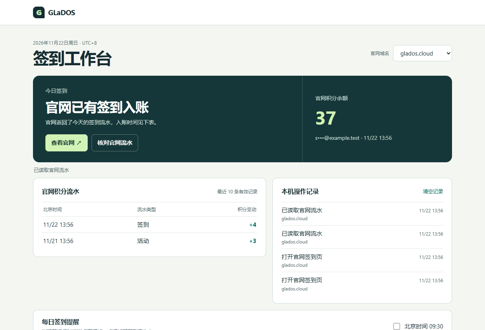

# GLaDOS 签到怎么选

如果已有定时签到，只想知道今天有没有入账，直接看云端日报。想在浏览器里自己确认账号、完成官网验证并查看流水，推荐使用**GLaDOS 签到工作台 0.2.2**。以下状态核对于 2026-11-26。

## 可使用的方案

| 我想做什么 | 选哪个，能看到什么 | 致谢和来源 |
| --- | --- | --- |
| 自己完成官网签到 | 打开[官网签到页](https://glados.cloud/console/checkin)，在自己的账号中完成页面要求的操作，再看当天的积分流水。 | 感谢 GLaDOS 提供官网入口，感谢 @chengchang1987-cloud 和 @1996yorkjiang-afk 提供积分变化和验证提示的观察。[#28](https://github.com/lankerr/2026-glados-checkin/issues/28) · [#37](https://github.com/lankerr/2026-glados-checkin/issues/37) |
| 已有本机定时任务 | 沿用[本地安装和配置](../README.md#local)。完整模式可能执行积分兑换，配置项见使用手册。遇到提交结果不明时，先到官网查当天流水。 | 感谢 @badpinkman 修复新版登录会话和 User-Agent 的兼容问题，感谢 @lankerr 维护安装器。[#18](https://github.com/lankerr/2026-glados-checkin/pull/18) · [#48](https://github.com/lankerr/2026-glados-checkin/pull/48) |
| 远程核对余额、连续签到天数 | Actions 定时任务默认查询状态；[连续签到日报](https://github.com/lankerr/2026-glados-checkin/actions/workflows/streak.yml)按账号解析 Cookie，按北京时间统计最近可见的 10 条流水，并在摘要中区分 HTTP 状态或配置错误。 | 感谢 @goehou 报告旧版报错，感谢 @lankerr 修正统计口径、`system:checkin` 标签与多账号诊断。[#39](https://github.com/lankerr/2026-glados-checkin/pull/39) · [#49](https://github.com/lankerr/2026-glados-checkin/pull/49) · [#57](https://github.com/lankerr/2026-glados-checkin/pull/57) |
| 在浏览器里提醒并核对入账（主推） | **[签到工作台 0.2.2](../webextension/README.md)**（支持 Chrome / Edge / Firefox 与 5 个官方域名）。人在官网操作，点击「核对官网流水」后才读取账号和积分；可选本地 09:30 提醒，初始关闭。 | 感谢 @lankerr 开发工作台，感谢 @Unexpectedlyc 为早期扩展补齐双语包，感谢 @EchoChan314 与 @mem4tgo 反馈旧版插件问题推动路线收敛。[#44](https://github.com/lankerr/2026-glados-checkin/pull/44) · [#50](https://github.com/lankerr/2026-glados-checkin/pull/50) · [#56](https://github.com/lankerr/2026-glados-checkin/pull/56) · [#58](https://github.com/lankerr/2026-glados-checkin/issues/58) |
| 此前安装过旧版 v0.1.x 浏览器插件 | 旧版自动点击插件已停用，请在浏览器扩展页移除旧版后改用签到工作台 0.2.2，详见[停用与迁移说明](../extension/README.md)。 | 感谢 @Unexpectedlyc、@EchoChan314、@mem4tgo 提供问题复现与修复线索。[#44](https://github.com/lankerr/2026-glados-checkin/pull/44) · [#50](https://github.com/lankerr/2026-glados-checkin/pull/50) · [#58](https://github.com/lankerr/2026-glados-checkin/issues/58) |
| 在微信或 Telegram 收到运行结果 | 在[使用手册](usage.md)选择通知渠道。消息中的「查询失败」表示这次没读到有效数据，可回官网核对。 | 感谢 @Ch3nSir 添加 Server酱 Turbo / Server酱³，感谢 @Initsnow 添加 Telegram 推送及通知级别。[#27](https://github.com/lankerr/2026-glados-checkin/pull/27) · [#3](https://github.com/lankerr/2026-glados-checkin/pull/3) |
| 在 NixOS 管理本地任务 | 主线已有 [NixOS 模块](../glados-checkin.nix)，可以用 systemd 管理服务与定时器。PR #47 提出的浏览器驱动另列在下表。 | 感谢 @Initsnow 提供 Flake 和模块，感谢 @Ch3nSir 补充通知配置。[#3](https://github.com/lankerr/2026-glados-checkin/pull/3) · [#27](https://github.com/lankerr/2026-glados-checkin/pull/27) |

安卓用户可直接运行[手机流水核对](android-ledger.md)。脚本逐账号只读查询，当天有明确签到入账才计入通知数字。感谢 @chengchang1987-cloud 提出手机端需求，@lankerr 提供 Termux 方案。[Issue #40](https://github.com/lankerr/2026-glados-checkin/issues/40) · [PR #54](https://github.com/lankerr/2026-glados-checkin/pull/54)

本地脚本发出签到 API 请求后，如果连接中断、服务返回错误或成功信息不明确，本轮会停止重发，改查积分流水，并跳过兑换。即便查到当天入账，通知仍会保留本次提交待核对的状态。本机人工浏览器还会按账号保留待核对标记，见[恢复步骤](usage.md#manual-browser)。感谢 @lankerr 整理重复提交的场景。[PR #38](https://github.com/lankerr/2026-glados-checkin/pull/38)

NixOS 用户可选 `mode = "ledger"` 仅核对流水，也可使用 `environmentFile` 和 `package`，让 systemd 在运行时读取凭据，并选择本机的软件包。感谢 @Initsnow 提供这两个设置的设计。[配置示例](usage.md#nixos) · [PR #47](https://github.com/lankerr/2026-glados-checkin/pull/47)

## 安装签到工作台 0.2.2

第一次安装可跟着[工作台图解与 Docker 实验](desk-walkthrough.md)操作，里面有余额相同、入账类型不同的两张对照图。

1. 前往 **[Releases v2026.11.26](https://github.com/lankerr/2026-glados-checkin/releases/tag/v2026.11.26)** 直接下载 `glados-desk-chromium-0.2.2.zip`（Chrome / Edge）或 `glados-desk-firefox-0.2.2.zip`（Firefox）。也可以在仓库根目录运行 `python webextension/build.py --out dist`，直接得到可加载的目录和 ZIP。
2. Chrome / Edge 解压 Chromium 包，在扩展管理页开启开发者模式，点「加载已解压的扩展程序」，选含 `manifest.json` 的目录。Firefox 140 及以上用「临时载入附加组件」打开 Firefox 包里的 `manifest.json`，重启后需重新载入。[安装说明与权限](../webextension/README.md)
3. 点击工作台图标，选官网域名并在官网登录账号。今天已有定时签到的，直接点「核对官网流水」；尚未签到的，先点「去官网签到」由本人在官网完成签到与验证，再回工作台核对。当天有带签到标签的正数入账，页面会显示「官网已有签到入账」。只有余额、补偿积分或缺少签到标签时，仍显示待确认。切换账号或退出登录后重新核对，旧读数会清空。

下图来自隔离浏览器里的模拟账号。示例余额为 37，当日签到 +4，前一天活动 +3。三个桌面浏览器的模拟账本均已读取成功，手机端仍待实机验证。

## 社区提案与收敛进展

[社区验收清单 #64](https://github.com/lankerr/2026-glados-checkin/issues/64) 跟踪浏览器隔离、NixOS 部署和安卓真机回执。

| 提案 | 解决的问题与当前状态 | 致谢和讨论 |
| --- | --- | --- |
| 日报显示「积分流水读取失败」（Issue #55、PR #57，已合入主线） | 修复版按账号解析 Cookie（含 JSON 导出与多账号），可在 Actions 摘要里看见哪一个账号读取失败，以及 HTTP 状态或错误类别。Fork 用户 Sync fork 即可生效。 | 感谢 @goehou 提供旧版报错，@lankerr 补充修复与测试。[Issue #55](https://github.com/lankerr/2026-glados-checkin/issues/55) · [PR #57](https://github.com/lankerr/2026-glados-checkin/pull/57) |
| 旧版插件的按钮识别、响应匹配与重复开页（PR #50、#53、#56，已由工作台 0.2.1 统一收敛） | 旧版 `v0.1.x` 受限于 MV3 隔离世界无法捕获页面请求、单域名写死及后台隐藏页无法完成人机验证；主线现统一升级为[签到工作台 0.2.2](../webextension/README.md)，直接在前台引导官网操作并读取真实流水。 | 感谢 @EchoChan314 定位中文按钮、`challenge` 误判与重复开页触发条件，@mem4tgo 报告实机故障。[PR #50](https://github.com/lankerr/2026-glados-checkin/pull/50) · [PR #53](https://github.com/lankerr/2026-glados-checkin/pull/53) · [PR #56](https://github.com/lankerr/2026-glados-checkin/pull/56) |
| 用系统浏览器运行（PR #47） | 在提交 `a7eda36` 上复测了三项本机连接防护：调试地址出错时只显示固定提示，本机发现请求直连并拒绝重定向。浏览器驱动尚未合入；NixOS 配置可独立使用，[服务验收 #66](https://github.com/lankerr/2026-glados-checkin/issues/66) 跟踪实际定时结果。 | 感谢 @Initsnow 提供实现、NixOS 配置并跟进修订。[PR #47](https://github.com/lankerr/2026-glados-checkin/pull/47) |
| 多账号隔离与重复提交保护（源自 PR #38） | 新版按账号保留结果未知的提交。遇到 HTTP 错误或无法识别的结果，即使跨日也会保留标记。旧版按日期留下的标记缺少账号信息，需先人工核对。 | 感谢 @lankerr 整理风险、提交隔离方案和离线测试。[PR #38](https://github.com/lankerr/2026-glados-checkin/pull/38) |
| 手机上完成日常签到（Issue #40、草稿 PR #54） | 主线可在配置账号前用测试消息检查通知。安卓真机的定时唤醒和通知送达仍待实测。 | 感谢 @chengchang1987-cloud 提出手机端需求，@lankerr 提交安卓提案。[Issue #40](https://github.com/lankerr/2026-glados-checkin/issues/40) · [PR #54](https://github.com/lankerr/2026-glados-checkin/pull/54) |
| 按官网 Current Index 提醒（Issue #45） | 建议提醒用户何时查看官网。目前仍在确认数据来源和指标含义，与签到积分之间的关系尚待证实。 | 感谢 @luckyboychn-ship 提出指标提醒建议。[Issue #45](https://github.com/lankerr/2026-glados-checkin/issues/45) |
| 在 NAS / Docker 上运行（Issue #51、#45） | 飞牛 OS 用户报告在自用环境中运行了修改过的脚本。项目的[只读日报容器示例](desk-walkthrough.md#container)已在 AMD64 原生、ARM64 模拟容器和本机 Compose 中跑通；容器无头首次签到受限于人机验证不作通用承诺。 | 感谢 @Takdrift 与 @badpinkman 提出 NAS / Docker 需求，@DyeDye-diyung 分享飞牛经验，@luckyboychn-ship 补充人工验证的使用场景。[Issue #51](https://github.com/lankerr/2026-glados-checkin/issues/51) · [Issue #45](https://github.com/lankerr/2026-glados-checkin/issues/45) |

本项目为社区工具。请仅在本人或获得明确授权的账号上使用，并遵守服务规则。遇到官网要求的人机验证，请本人在官网完成。签到结果和奖励以账号的实际流水为准。
