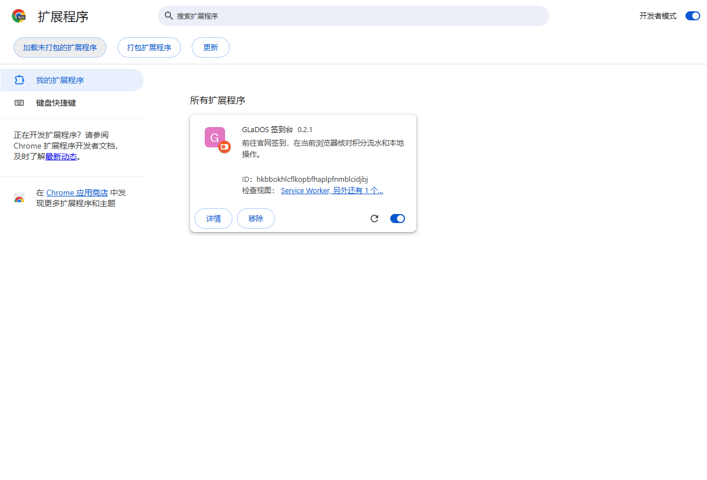
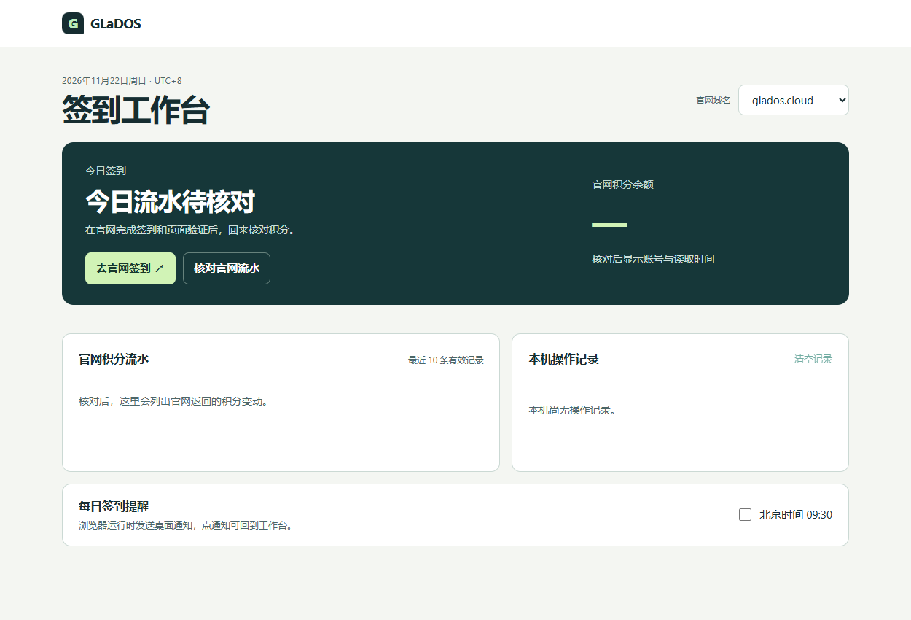
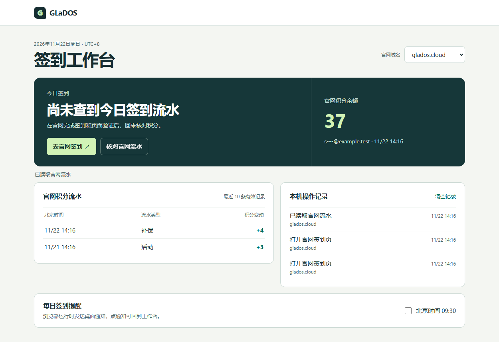
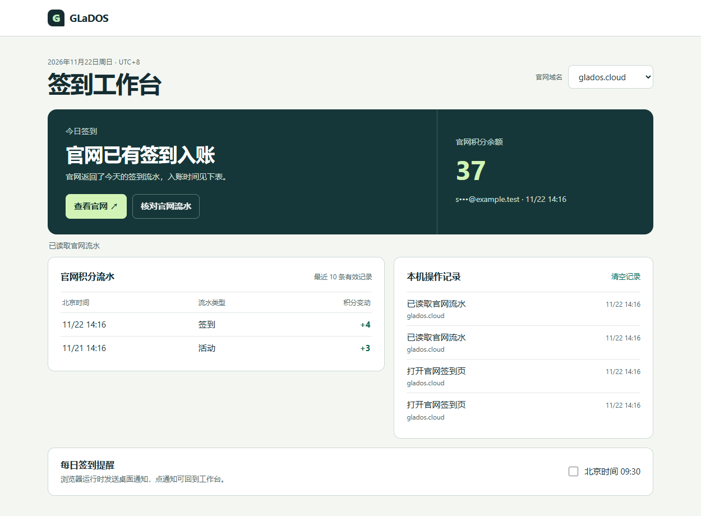
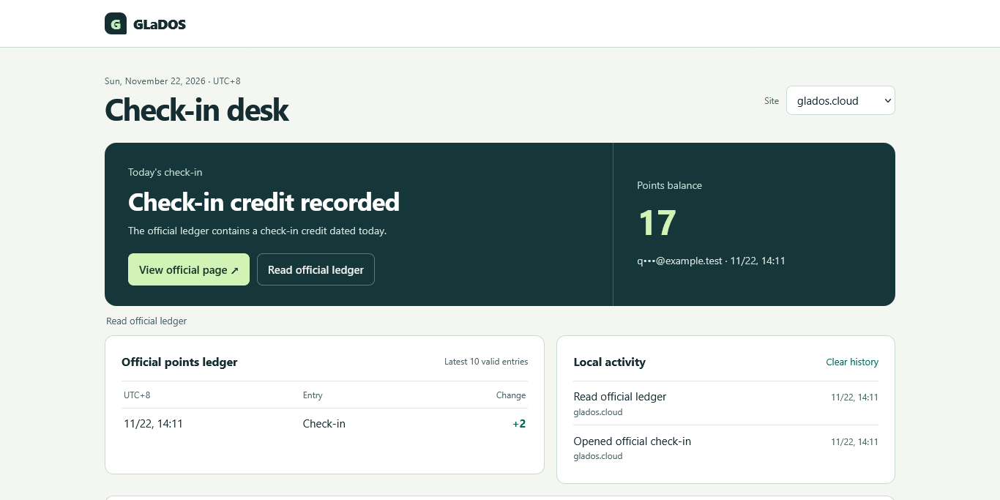
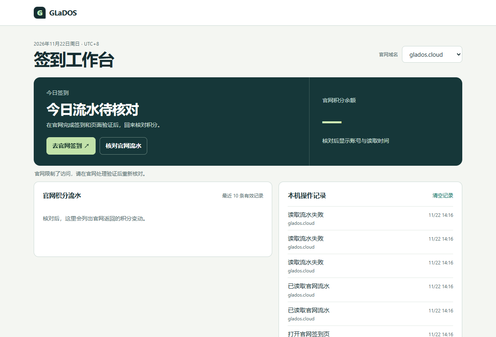
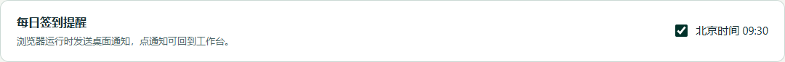
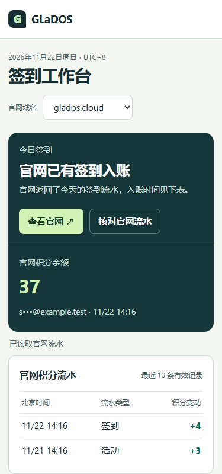
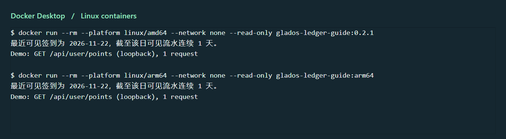

# GLaDOS 签到工作台图解：看懂今天有没有入账

看到微信通知「成功 0/1」或「未收到有效 API 响应」，当时能确定的是脚本没读到有效结果。要知道今天签没签，打开官网查当天的积分流水。已经有定时任务的用户，可以用独立工作台核对一次，无需再提交签到。

本教程对应工作台 **0.2.1**，实测于 **2026-11-22**。浏览器截图都来自本地模拟账号。Chrome 示例的余额是 37，Firefox 示例的余额是 17。只想核对自己账号的读者看前三节即可，NAS 用户可以直接看[容器实验](#container)。

## 一、安装签到工作台 0.2.1

1. 前往 **[Releases v2026.11.24](https://github.com/lankerr/2026-glados-checkin/releases/tag/v2026.11.24)** 直接下载 `glados-desk-chromium-0.2.1.zip`（Chrome / Edge）或 `glados-desk-firefox-0.2.1.zip`（Firefox 140+），无需登录即可下载。如浏览器中曾安装旧版 `0.1.x` 插件，请先将其移除。
2. 解压 `glados-desk-chromium-0.2.1.zip`（首次试用也可以在 Chrome 或 Edge 的头像菜单新建一个独立浏览器配置）。Chrome 在地址栏输入 `chrome://extensions`，Edge 输入 `edge://extensions`。打开「开发者模式」，点击「加载已解压的扩展程序」，选中能直接看到 `manifest.json` 的那层文件夹。看到下图中的「GLaDOS 签到台 0.2.1」且开关已开启，就可以从工具栏的扩展菜单打开它。[Chrome 安装说明](https://developer.chrome.com/docs/extensions/get-started/tutorial/hello-world)
3. Firefox 用户解压 `glados-desk-firefox-0.2.1.zip`，在 Firefox 140 或更新版本打开 `about:debugging#/runtime/this-firefox`，点击「临时载入附加组件」并选择 `manifest.json`。重启 Firefox 后需再次载入。[Mozilla 临时安装说明](https://extensionworkshop.com/documentation/develop/temporary-installation-in-firefox/)



如果想从源码自行打包，可在仓库根目录运行下面的命令，到 `dist` 里选对应浏览器的文件夹即可：

```sh
python webextension/build.py --out dist
```

## 二、打开官网，再核对一次

首次打开会看到「今日流水待核对」，余额显示横线。右上角选择自己登录的官网域名，点 **去官网签到**，在新窗口里登录自己的账号。当天已经签过的，直接回工作台点 **核对官网流水**。当天还没签的，先在官网完成操作，再回来核对。官网如果显示人机验证，在官网页面按提示完成。



**同样是 +4，怎么判断？** 看下面两张图。第一张里余额是 37，今天的 +4 标为「补偿」，所以页面显示「尚未查到今日签到流水」。这时仅凭余额或一笔加分，无法断定今天是否签过。



第二张里余额仍是 37，今天的 +4 标为「签到」，页面才显示 **官网已有签到入账**。右侧「本机操作记录」中的「打开官网签到页」只代表打开过页面。工作台按北京时间判断「今天」，流水也无法指出是哪个脚本触发了奖励。



Firefox 的英文界面里，相同操作叫 **Read official ledger**。另一个模拟账号的当天流水为 +2，余额为 17，状态为 **Check-in credit recorded**。



## 三、读数失败、提醒与手机布局

| 页面上看到什么 | 接下来做什么 |
| --- | --- |
| 提示先打开官网签到页 | 在同一浏览器配置、同一窗口打开所选域名的签到页，完成登录，再回工作台核对。 |
| 提示登录，或提示账号已切换 | 去官网看当前登录的是哪个账号，回来重新核对。工作台会清除上一次显示的账号和余额。 |
| 提示「官网限制了访问」 | 打开官网看具体要求。官网出现验证时请本人完成。读取接口返回 403 只能说明访问受限，单凭这个状态码无法判断是否出现了人机验证。 |
| 有余额，仍提示「尚未查到今日签到流水」 | 看日期和流水类型。只有活动、补偿或不带标签的记录时，保留「待确认」，可稍后再读一次。 |
| 微信显示「成功 0/1」，积分和天数都是问号 | 看消息的日期，到官网查同一天的流水。没有读数时，问号不能用来计算漏签天数。 |
| Actions 连续签到日报只提示「积分流水读取失败」 | 旧版会把多种原因显示为同一行。[修复版 #57](https://github.com/lankerr/2026-glados-checkin/pull/57) 已合入主线（Fork 用户 Sync fork 即可生效），在 Summary 里按账号显示 HTTP 状态、超时或配置错误，其他账号仍能单独核对。感谢 @goehou 报告。[Issue #55](https://github.com/lankerr/2026-glados-checkin/issues/55) |



需要提醒时勾选页面底部的 **北京时间 09:30**。实测重新打开工作台后设置仍在，取消勾选后浏览器的提醒任务也随之清除。设备休眠和浏览器关闭可能影响送达时间。



下面是 375 像素宽的桌面浏览器窗口。余额和流水在窄屏下排成一列。本次没有连接手机实机，Android、iOS 的扩展安装和系统通知仍待验证。感谢 @chengchang1987-cloud 提出手机端需求。[Issue #40](https://github.com/lankerr/2026-glados-checkin/issues/40)



<a id="container"></a>
## 四、NAS 用户先做一个断网也能跑的容器实验

这个实验回答一个具体问题：设备的 Docker 能否运行项目的只读日报，并正确处理签到和补偿混在一起的账本？它使用合成账号和容器内部的 HTTP 服务。准备好 Docker 后，在仓库根目录运行，构建阶段需要联网。

```sh
docker build -f docs/examples/ledger/Dockerfile -t glados-ledger-guide:0.2.1 .
docker run --rm --network none --read-only glados-ledger-guide:0.2.1
```

样例给出三天的流水：今天签到 +4，昨天补偿 +3，前天签到 +2。昨天的补偿使连续签到中断，所以输出应为「截至该日可见流水连续 **1 天**」。下一行 `GET /api/user/points (loopback), 1 request` 表示日报只读取了一次容器内的样例积分接口。日期会随运行日变化。示例直接调用仓库日报入口。[样例源码](examples/ledger/demo.py) · [Docker 的 none 网络](https://docs.docker.com/engine/network/drivers/none/)



上图记录的是 Windows 上 Docker Desktop 的实际命令和输出。x86-64 容器原生运行，ARM64 容器在同一台 x86-64 主机上模拟执行，两者均通过。想多查一步，可以运行同一镜像中的三项日报回归测试。看到 `Ran 3 tests` 和 `OK` 即通过。

```sh
docker run --rm --network none --read-only --tmpfs /tmp glados-ledger-guide:0.2.1 python -m unittest discover -s tests -p test_update_streak.py
```

已有 Compose 的设备，在本机建好上面的镜像后也可以执行下列命令。实验是一次性任务，读完流水就退出，退出码 0 表示正常结束。用群晖界面查看容器时，可以在日志里找相同的两行输出。Compose 示例使用本机镜像，运行时无需映射端口、数据目录或账号信息。[Compose 示例](examples/ledger/compose.yaml) · [群晖 Container Manager 说明](https://kb.synology.cn/zh-cn/DSM/help/ContainerManager/docker_container)

```sh
docker compose -p glados-ledger-demo -f docs/examples/ledger/compose.yaml run --rm ledger
```

要在支持多架构模拟的 x86 电脑复现图中的 ARM64 一行，可以单独构建对应架构的镜像，再执行同一个样例。

```sh
docker buildx build --platform linux/arm64 --load -f docs/examples/ledger/Dockerfile -t glados-ledger-guide:arm64 .
docker run --rm --platform linux/arm64 --network none --read-only glados-ledger-guide:arm64
```

**飞牛和群晖分别有什么依据？** @DyeDye-diyung 报告在自己的飞牛系统中使用了修改过的脚本。@Takdrift 询问群晖并表示准备试用，讨论里尚无群晖实机结果。本次容器实验覆盖 Python 运行和账本判断；NAS 面板安装、定时唤醒、官网登录及消息送达仍需要对应设备验证。感谢两位分享使用背景，也感谢 @luckyboychn-ship 提醒本地运行仍可能遇到人工验证。[NAS 讨论 #51](https://github.com/lankerr/2026-glados-checkin/issues/51)

## 五、日报、NixOS 和两条外部 PR

| 想了解什么 | 这次查到了什么 | 致谢 |
| --- | --- | --- |
| GitHub Actions 的日报 | [打开一次成功运行的日报](https://github.com/lankerr/2026-glados-checkin/actions/runs/44975600453)，在 Summary 读「最近可见签到」和「连续天数」。统计窗口为最近返回的 10 条流水；更早的记录需要其他来源。 | 感谢 @lankerr 补全 `system:checkin` 的识别。[PR #49](https://github.com/lankerr/2026-glados-checkin/pull/49) |
| NixOS 定时器 | 用模拟配置求值后，主线的任务类型为 `oneshot`，按系统本地时间 09:30 触发，随机延迟最多 10 分钟，`Persistent` 为真。本次验证了生成的配置，未做整机启动或跨天唤醒测试。 | 感谢 @Initsnow 提供 Flake 与 NixOS 模块。[PR #3](https://github.com/lankerr/2026-glados-checkin/pull/3) |
| PR #47 的系统浏览器方案 | 对 PR 提交 `27b0b1a` 的 NixOS 模块单独求值，读到了新增的状态目录 `glados-checkin` 和工作目录 `%S/glados-checkin`。实测覆盖服务配置；浏览器登录和官网验证仍由用户在官网完成。 | 感谢 @Initsnow 提供部署实现。[PR #47](https://github.com/lankerr/2026-glados-checkin/pull/47) |
| PR #50 的中文页面修复 | 用本地虚构地址单测贡献者的响应路径判断。它能排除准备验证的响应；其他来源的同名路径、同一来源的不同前缀仍可能匹配。工作台直接读取带日期和类型的积分流水。 | 感谢 @EchoChan314 在中文 Edge 找出按钮识别和误报两个问题。[PR #50](https://github.com/lankerr/2026-glados-checkin/pull/50) |
| 微信和 Telegram 通知 | 16 项离线通知测试通过，覆盖 Server酱请求格式、多渠道分发和诊断模式跳过推送等场景。实际手机收件本轮未测。 | 感谢 @Ch3nSir 提供 Server酱，@Initsnow 提供 Telegram 推送。[PR #27](https://github.com/lankerr/2026-glados-checkin/pull/27) · [PR #3](https://github.com/lankerr/2026-glados-checkin/pull/3) |

在已安装 Nix 的环境，从仓库根目录可以复查 NixOS 的配置值。命令读取仓库锁定的 nixpkgs，首次求值需要联网。

```sh
nix --extra-experimental-features 'nix-command flakes' eval --impure --json --file docs/examples/check-timer.nix
```

桌面验收覆盖 Chrome 157、Edge 157、Firefox 160.0.1；中文分步截图取自 Chrome for Testing 145，Firefox 截图取自 Firefox 160.0.1。感谢 @Unexpectedlyc 为经典扩展补上中英语言包，感谢 @badpinkman 为本地登录状态排查提供基础。其他部署方式及逐项贡献见[方案与致谢](checkin-options.md)。
